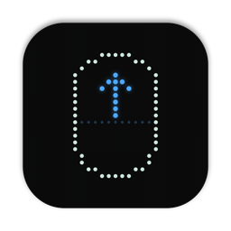
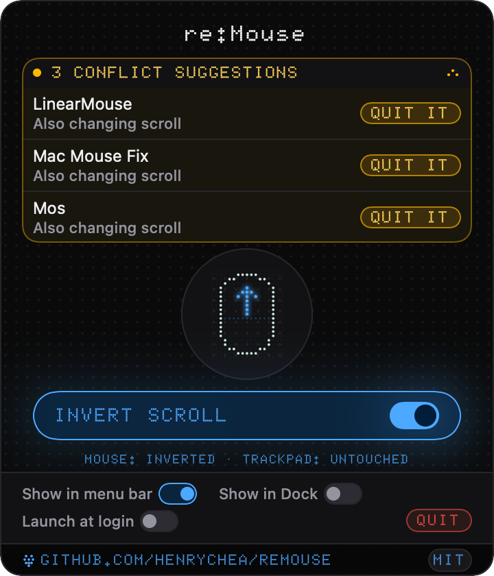
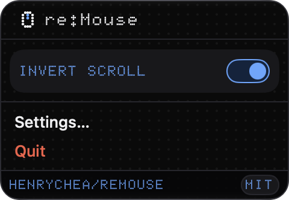

<p align="center">
  
</p>

<h1 align="center">re:Mouse</h1>

<p align="center"><strong>Invert your mouse wheel. Leave your trackpad alone.</strong></p>

<p align="center">
  
  <a href="LICENSE"></a>
  
  
</p>

<p align="center">
  
</p>

A tiny macOS menu-bar app that inverts scroll direction **for wheel mice only**. Trackpad and Magic Mouse scrolling is passed through untouched.

Pairs with "natural" scrolling turned on: trackpad gesture scrolling stays natural, and a traditional mouse wheel scrolls the way your hands expect.

- Single 100 ms event tap, no polling, no background daemons, no third-party dependencies.
- Built to be restyled: all UI lives in `reMouse/Views.swift`.

[Website](https://henrychea.github.io/remouse/) · [Download](https://github.com/henrychea/remouse/releases/latest) · [How it works](#how-it-works) · [Conflicts](#conflicts)

---

## Why

There are several good scroll utilities. re:Mouse exists for the one job they bury under settings:

|  | re:Mouse | LinearMouse | Scroll Reverser | Mac Mouse Fix |
| --- | --- | --- | --- | --- |
| Focus | wheel direction only | input remapping engine | direction for mouse + trackpad | buttons, gestures, scrolling |
| Knobs | one switch | per-device rules, curves | direction toggles | extensive |
| License | MIT | MIT | Apache-2.0 | source-available |

- **One switch.** No per-app rules, no acceleration curves, no profile editor. Toggle it in the menu bar; that is the whole configuration.
- **Mouse only.** Wheel events invert, continuous events from trackpads and the Magic Mouse do not. Your trackpad never flips just because you fixed your mouse.
- **No clutter.** Menu-bar toggle, one settings window, three checkboxes. Nothing else to learn.
- **Yours.** MIT, under 2 MB, no dependencies, no telemetry. Restyle the whole UI in a single Swift file.

## Features

- **Wheel-only inversion** — discrete wheel events are negated, continuous (trackpad / Magic Mouse) events pass through untouched.
- **One event tap** — installed on the session at 100 ms, callback is allocation-free, and the tap re-enables itself if macOS disables it.
- **Menu-bar toggle** — flip inversion from the menu without opening a window.
- **Small settings window** — invert on/off, show menu-bar icon, show in Dock, launch at login ([`SMAppService`](https://developer.apple.com/documentation/servicemanagement/smappservice)).
- **Conflict check** — finds the known scroll inverters and offers a Quit button for each.
- **No sandbox, no helper** — the App Sandbox forbids modifying event taps for other apps, so this app ships outside it on purpose.
- **Restylable** — every view lives in `reMouse/Views.swift`; the dot-matrix glyphs live in `reMouse/DotMatrix.swift`.

## Install

Free, MIT, macOS 13.1 or later.

### Download

**[Download re:Mouse →](https://github.com/henrychea/remouse/releases/latest)** — unzip and move `reMouse.app` to `/Applications`.

The release is ad-hoc signed rather than notarized, so the first launch needs one extra step: right-click the app → **Open**, or clear the quarantine flag:

```sh
xattr -dr com.apple.quarantine /Applications/reMouse.app
```

### Build from source

Requirements: macOS 13.1 or later, Xcode 15 or later.

```sh
git clone https://github.com/henrychea/remouse.git && cd remouse
open reMouse.xcodeproj
```

The app presents itself as **re:Mouse** everywhere in the UI; the bundle on disk stays `reMouse.app` because a colon in a file name is not usable in paths (Finder renders it as a slash).

Select the `reMouse` scheme and run, or from the command line:

```sh
xcodebuild -scheme reMouse -configuration Debug build
```

The source build is ad-hoc signed (`CODE_SIGN_IDENTITY = "-"`, empty `DEVELOPMENT_TEAM`), so if you move it to another Mac, macOS quarantines it. Right-click the app → **Open** the first time, or:

```sh
xattr -d com.apple.quarantine /Applications/reMouse.app
```

On first launch the app asks for **Accessibility** permission. The event tap can only be installed after that is granted (System Settings → Privacy & Security → Accessibility). Until then the app keeps polling and installs the tap as soon as the checkbox is ticked.

### Check the invert rule

The invert rule is a pure function in `reMouse/ScrollInverter.swift`, covered by a standalone check that compiles the real source file:

```sh
./check.sh
```

## How it works

A head-insert `CGEventTap` on `kCGSessionEventTap` masks `scrollWheel`. Wheel events (`kCGScrollWheelEventIsContinuous == 0`) get `DeltaAxis1/2`, `PointDeltaAxis1/2` and `FixedPtDeltaAxis1/2` negated. Continuous events — trackpads and the Magic Mouse — return untouched. The callback is allocation-free, and the tap re-enables itself on `kCGEventTapDisabledByTimeout` / `kCGEventTapDisabledByUserInput`.

That is the whole mechanism: no device matching, no per-app rules, no daemon.

## Conflicts

Only one tool should rewrite scroll events. At launch, and whenever inversion is switched on, re:Mouse checks for the known scroll inverters and offers a **Quit** button for each:

| App | Bundle ID |
| --- | --- |
| LinearMouse | `com.lujjjh.LinearMouse` |
| Scroll Reverser | `com.pilotmoon.scroll-reverser` |
| Mac Mouse Fix | `com.nuebling.mac-mouse-fix`, `com.nuebling.mac-mouse-fix.helper` |
| Mos | `com.caldis.Mos` |
| UnnaturalScrollWheels | `com.theron.UnnaturalScrollWheels` |

## Privacy

- No network access. The app never opens a socket.
- No analytics, no crash reporting, no identifiers, no data collection.
- Settings stay in local `UserDefaults` (`com.henrychea.reMouse`).
- The only permission requested is **Accessibility**, which is what any event tap requires.
- No helper processes, no background agents. The optional login item is a standard `SMAppService` registration.

## Uninstall

1. Turn off **Launch at login** in the settings window.
2. Quit re:Mouse from the menu bar.
3. Move `reMouse.app` from `/Applications` to the Trash.
4. Optional: clear preferences with `defaults delete com.henrychea.reMouse`, then remove re:Mouse from System Settings → Privacy & Security → Accessibility.

## Screenshots

| Inverted | Conflicts | Accessibility | Menu bar |
| :---: | :---: | :---: | :---: |
|  |  |  |  |
| **INVERT SCROLL** on | **3 conflict suggestions** | **Needs Accessibility** | **Menu-bar toggle** |

## Why not on the App Store?

The App Sandbox forbids an event tap that modifies other apps' input, so a sandboxed build could only listen and never invert — see [the spike result](docs/notes/sandbox-spike.md).

## Credits

Approach informed by [LinearMouse](https://github.com/linearmouse/linearmouse) (MIT) and [Scroll Reverser](https://github.com/pilotmoon/Scroll-Reverser) (Apache-2.0). No code from Mac Mouse Fix is used — its license forbids it.

## License

MIT — see [LICENSE](LICENSE).
