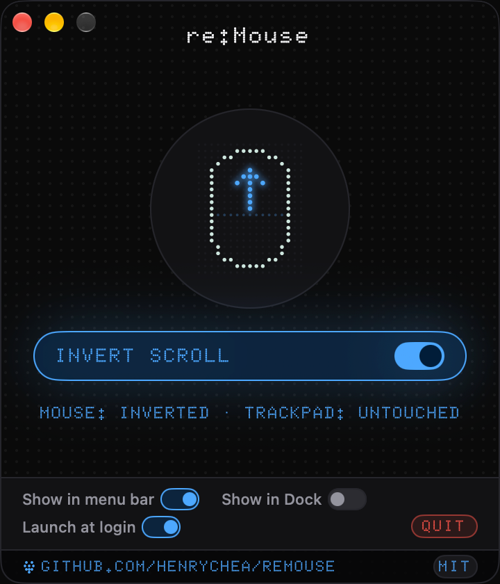
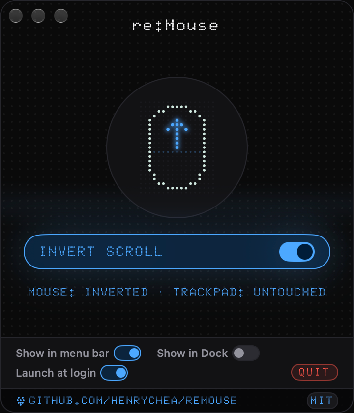

<p align="center">
  
</p>

<h1 align="center">re:Mouse: invert mouse scroll on Mac, keep trackpad natural</h1>

<p align="center">re:Mouse is a free macOS menu-bar app that reverses mouse-wheel scrolling while keeping trackpad and Magic Mouse gestures natural.</p>

<p align="center">
  
  <a href="LICENSE"></a>
  
  
  <a href="https://github.com/henrychea/remouse/actions/workflows/release.yml"></a>
  <a href="https://henrychea.github.io/remouse/"></a>
</p>

<p align="center">
  
</p>

It is the short answer to “natural scrolling on the trackpad but not the mouse”: wheel and trackpad directions are separate, so you can reverse mouse scroll on a Mac without flipping the setting for every device. Trackpad and Magic Mouse gestures pass through untouched, while a wheel mouse scrolls the classic way. If you have been looking for a [Scroll Reverser](https://pilotmoon.com/scrollreverser/) alternative that inverts scroll direction for the mouse only, this is the whole app.

Pairs with "natural" scrolling turned on: trackpad gesture scrolling stays natural, and a traditional mouse wheel scrolls the way your hands expect.

- A single event tap, no background daemons, no third-party dependencies. Polling runs only while the app waits for Accessibility permission.
- Built to be restyled: all UI lives in `reMouse/Views.swift`.

[Website](https://henrychea.github.io/remouse/) · [Download](https://github.com/henrychea/remouse/releases/latest) · [How it works](#how-it-works) · [Conflicts](#conflicts)

---

## Why

There are several good scroll utilities. re:Mouse exists for the one job they bury under settings:

| | re:Mouse | Scroll Reverser | LinearMouse | Mac Mouse Fix |
| --- | --- | --- | --- | --- |
| Focus | wheel direction, smooth scroll, ⌘ zoom | direction for mouse and trackpad, per device | input remapping engine | buttons, gestures, smooth scrolling |
| Separate mouse and trackpad direction | Yes | Yes | Yes | Yes |
| Extra features | smooth scroll with per-app exclusion, ⌘ + wheel zoom, conflict check, menu-bar toggle | a direction setting for each device | per-device and per-app profiles, acceleration tuning, button remapping | button remapping, gestures, smooth scrolling |
| License | MIT | Apache-2.0 | MIT | MMF 3: paid after trial, custom MMF License; MMF 2: free |
| Price | Free | Free | Free | MMF 3: paid after trial; MMF 2: free |

Each rival's own site is the source: [Scroll Reverser](https://pilotmoon.com/scrollreverser/), [LinearMouse](https://linearmouse.app/en/), [Mac Mouse Fix](https://macmousefix.com/). Mac Mouse Fix price and license as of Nov 2026. re:Mouse is also the LinearMouse alternative for someone who wants only the wheel flipped: no device rules, no acceleration curves, no profile editor.

## Features

- **Wheel-only inversion** — discrete wheel events are negated; continuous events (trackpad, Magic Mouse, some smooth-scroll mice) pass through untouched.
- **Smooth scroll** — each wheel notch becomes an eased pixel glide instead of a line jump; trackpad input stays untouched, Shift + wheel still scrolls sideways, and an on/off switch lives in the settings window.
- **Per-app exclusion** — turn smooth scroll off for apps with their own scroll engine, such as Moonlight. Invert and zoom still apply there.
- **⌘ + wheel zoom** — hold Command and scroll to send ⌘= or ⌘−, one per notch; it follows the invert direction and has its own on/off switch.
- **One event tap** — installed on the session, callback is allocation-free, and the tap re-enables itself if macOS disables it.
- **Menu-bar toggle** — flip inversion from the menu without opening a window.
- **Small settings window** — invert on/off, smooth scroll on/off, ⌘ + scroll zoom on/off, per-app exclusions, show menu-bar icon, show in Dock, launch at login ([`SMAppService`](https://developer.apple.com/documentation/servicemanagement/smappservice)).
- **Conflict check** — finds the known scroll inverters and offers a Quit button for each.
- **No sandbox, no helper** — in our tested implementation the App Sandbox refused a scroll-modifying event tap ([spike result](docs/notes/sandbox-spike.md)), so this app ships outside it on purpose.
- **Restylable** — every view lives in `reMouse/Views.swift`; the dot-matrix glyphs live in `reMouse/DotMatrix.swift`.

## Install

Free, MIT, macOS 13.1 or later.

### Download

**[Download re:Mouse →](https://github.com/henrychea/remouse/releases/latest)** — open the DMG and drag **re:Mouse** onto the Applications folder.

The release is ad-hoc signed, not notarized, so the first launch needs one extra step. Since macOS 15 there is no right-click → **Open** shortcut: launch it once, then open **System Settings → Privacy & Security** and click **Open Anyway** next to re:Mouse.

Advanced: clear the quarantine flag instead, which skips the prompt.

```sh
xattr -dr com.apple.quarantine /Applications/reMouse.app
```

### Build from source

Requirements: macOS 13.1 or later, Xcode 15 or later.

```sh
git clone https://github.com/henrychea/remouse.git && cd remouse
open reMouse.xcodeproj
```

The app presents itself as **re:Mouse** everywhere in the UI; the bundle on disk stays `reMouse.app` because a colon in a file name is not usable in paths (Finder renders it as a slash).

Select the `reMouse` scheme and run, or from the command line:

```sh
xcodebuild -scheme reMouse -configuration Debug build
```

The source build is ad-hoc signed (`CODE_SIGN_IDENTITY = "-"`, empty `DEVELOPMENT_TEAM`), so if you move it to another Mac, macOS quarantines it. Launch it once and approve it in **System Settings → Privacy & Security → Open Anyway**. Advanced: `xattr -dr com.apple.quarantine /Applications/reMouse.app`

On first launch the app asks for **Accessibility** permission. The event tap can only be installed after that is granted (System Settings → Privacy & Security → Accessibility). Until then the app keeps polling and installs the tap as soon as the checkbox is ticked.

### Check the invert rule

The invert rule is a pure function in `reMouse/ScrollInverter.swift`, covered by a standalone check that compiles the real source file:

```sh
./check.sh
```

### Releasing

Tag a version and push the tag. [`.github/workflows/release.yml`](.github/workflows/release.yml) then builds the DMG on macOS 15, checksums it, and attaches both files to the GitHub Release. Release notes come from the annotated tag message, so each release can say what changed for users:

```sh
git tag -a v1.1.0 -F notes.txt && git push origin v1.1.0
```

The tag sets the version: `v1.1.2` becomes `CFBundleShortVersionString` `1.1.2`, and `CFBundleVersion` is the workflow run number. No secrets are needed, because the app is ad-hoc signed, not notarized. Running the workflow by hand builds the DMG as a workflow artifact and creates no release.

The same build runs locally: `VERSION=1.0.1 BUILD=7 scripts/make-dmg.sh` writes `build/re-Mouse-1.0.1.dmg`.

## How it works

A head-insert `CGEventTap` on `kCGSessionEventTap` masks `scrollWheel`. Wheel events (`kCGScrollWheelEventIsContinuous == 0`) get `DeltaAxis1/2`, `PointDeltaAxis1/2` and `FixedPtDeltaAxis1/2` negated. Continuous events — trackpads and the Magic Mouse — return untouched. The callback is allocation-free, and the tap re-enables itself on `kCGEventTapDisabledByTimeout` / `kCGEventTapDisabledByUserInput`.

Smooth scroll and zoom reuse that tap. When smooth scroll is on, a discrete notch is dropped and added to a pending pixel target; a 120 Hz main-run-loop timer replays it as short `.pixel` events marked with `eventSourceUserData`, so the tap skips its own output. Each tick emits a fraction of what remains, fast spins carry further, and the timer stops below one pixel. The cached frontmost app is checked against the exclusion list first, so excluded apps get the plain event. Command + wheel posts `Cmd+=` or `Cmd+-` key events, one per notch, after the invert rule.

There is still no device matching and no daemon.

## Conflicts

Only one tool should rewrite scroll events. At launch, and whenever inversion is switched on, re:Mouse checks for the known scroll inverters and offers a **Quit** button for each:

| App | Bundle ID |
| --- | --- |
| LinearMouse | `com.lujjjh.LinearMouse` |
| Scroll Reverser | `com.pilotmoon.scroll-reverser` |
| Mac Mouse Fix | `com.nuebling.mac-mouse-fix`, `com.nuebling.mac-mouse-fix.helper` |
| Mos | `com.caldis.Mos` |
| UnnaturalScrollWheels | `com.theron.UnnaturalScrollWheels` |

## Privacy

- No network access. The app never opens a socket.
- No analytics, no crash reporting, no identifiers, no data collection.
- Settings stay in local `UserDefaults` (`com.henrychea.reMouse`).
- The only permission requested is **Accessibility**, which is what any event tap requires.
- No helper processes, no background agents. The optional login item is a standard `SMAppService` registration.

## Uninstall

1. Turn off **Launch at login** in the settings window.
2. Quit re:Mouse from the menu bar.
3. Move `reMouse.app` from `/Applications` to the Trash.
4. Optional: clear preferences with `defaults delete com.henrychea.reMouse`, then remove re:Mouse from System Settings → Privacy & Security → Accessibility.

## Screenshots

| Inverted | Conflicts | Accessibility | Menu bar |
| :---: | :---: | :---: | :---: |
|  |  |  |  |
| **INVERT SCROLL** on | **3 conflict suggestions** | **Needs Accessibility** | **Menu-bar toggle** |

## Why not on the App Store?

In our tested implementation, the App Sandbox refused an event tap that modifies input: a sandboxed build could only listen and never invert — see [the spike result](docs/notes/sandbox-spike.md).

## Credits

Approach informed by [LinearMouse](https://github.com/linearmouse/linearmouse) (MIT) and [Scroll Reverser](https://github.com/pilotmoon/Scroll-Reverser) (Apache-2.0). No code from Mac Mouse Fix is used.

## License

MIT — see [LICENSE](LICENSE).
